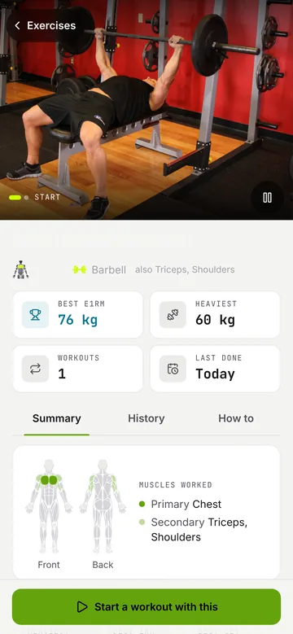

# ABOT: Gym Progress Tracker

[](https://github.com/jfr-wrld/ABOT/actions/workflows/android.yml)

ABOT (Javanese for "heavy") is a strength-training log for your phone. Log sets in the gym, keep
your routines, watch your records and progress, and share a finished workout to your Instagram
Story. It works offline, needs no account, and keeps your training on your phone. Google sign-in
is optional, for a cloud backup and the same data on two phones.

ABOT runs as an **Android app** (built with Capacitor) and in the **browser**, in **English and
Bahasa Indonesia**, with a dark and a light theme.

<p>
  
  
  
  
  
</p>

## Contents

- [Download and install (Android)](#download-and-install-android)
- [Features](#features)
- [Your data and privacy](#your-data-and-privacy)
- [Build from source](#build-from-source)
- [Project layout](#project-layout)
- [Tests and the local-first audit](#tests-and-the-local-first-audit)
- [Contact](#contact)
- [Credits and license](#credits-and-license)
- [Ringkasan (Bahasa Indonesia)](#ringkasan-bahasa-indonesia)

## Download and install (Android)

ABOT is not on Google Play yet. Every push builds a ready-to-install APK in GitHub Actions.

1. Open the [Android APK workflow](https://github.com/jfr-wrld/ABOT/actions/workflows/android.yml)
   (you need to be signed in to GitHub) and pick the latest run with a green check.
2. Scroll to **Artifacts** and download **abot-debug-apk**. It is a `.zip`.
3. Unzip it on the phone (Files app, tap the zip, **Extract**) or on a computer, then copy
   `app-debug.apk` to the phone (USB, Google Drive or Telegram; WhatsApp can mangle APKs).
4. Tap `app-debug.apk`. Android asks to allow **Install unknown apps** for the app you opened it
   with: allow it once, then tap **Install**.
5. If **Play Protect** warns about an unknown app, tap **More details**, then **Install anyway**.
   If the install hangs on "Installing", choose **Install without scanning** or pause Play
   Protect's scan for a moment.
6. Open ABOT. After the intro, **Allow access** explains each permission (notifications, camera,
   location). Allow the ones you want; Settings can change them later.

**Updating:** install a newer APK over the old one; your data stays. Every build since 1.0.5 is
signed with the same key and numbered (Settings shows the version at the bottom). An APK from
before 1.0.5 must be uninstalled once: export a backup first (Settings, Data & backup) or sign
in with Google, then import or sign in again after installing.

**Requirements:** Android 7.0 or newer. The live workout chip in the status bar needs Android 16.

## Features

### Logging
- Start an empty workout or one from a routine; add exercises, then log weight, reps and
  optional RPE per set. Warm-up, drop and failure sets are marked by letter.
- Previous numbers for each set, plates and bar per gym, supersets, reorder and replace.
- A rest timer starts when you tick a set; it sits above the tab bar within thumb reach.
- Pause and resume the workout clock.

### Workout in the notification panel (Android)
- While a workout runs, a notification shows the next lift and set, the workout, and a clock
  Android ticks itself: rest counting down, otherwise workout time.
- **Pause / Resume** and **Skip rest** buttons on the notification.
- The end of a rest rings and buzzes, even with ABOT in the background.
- On Android 16 the clock shows as a chip in the status bar (Live Update).

### Routines and templates
- Your own routines, plus a Template Vault of ready programs (PPL, Upper/Lower, Full Body,
  Calisthenics) to start or copy.
- Weekly workout schedule with reminders and a pack-your-bag call; on Android they arrive
  while ABOT is closed, with Start and Snooze buttons. The schedule also exports to your calendar.

### Progress and records
- Home: this week at a glance, volume, training days, muscle recovery and recent workouts.
- Records count once per lift per workout: heaviest weight, best estimated 1RM (Epley) and most
  volume in a set. The first time you log a lift is your baseline, not a record.
- Workout summary with a comparison to last time; workout detail with a body map of the
  muscles worked; lift trends, weekly volume and a training calendar on Profile.
- Bodyweight log.

### Exercises
- 88 built-in exercises with start and end photos that play like a short loop, steps and form
  cues, and a muscle map. About 800 more from the full catalog, downloaded once on request.
- Your own exercises, with a video link if you like.

### Share to Instagram Stories
- Story Studio turns a workout into a 1080 x 1920 card in eleven layouts.
- Add a background photo from the camera or the gallery, with overlay and black-and-white.
- Your @username (from Profile) on every layout. Share opens the phone's share sheet, where
  Instagram Stories is a target; Download saves the PNG to the gallery (album ABOT).

### Gyms
- Bar weight and plates per gym; machine records stay per gym.
- Pin a gym where it is: a workout started within about 300 m picks it by itself (Android,
  with location allowed).

### Settings
- General: language (Phone, English, Bahasa Indonesia; Phone follows the phone's language),
  theme (System, Dark, Light), kg or lbs, first day of the week.
- The whole interface is translated. Exercise names, instructions and the story card layouts
  stay in English.
- Workout, Notifications (with a test alert), Data & backup, app permissions.
- FAQ, About, Contact us, social links (coming soon), Sign out.

### Backup and sync
- Export and import everything as a JSON file (`ABOT_BACKUP_YYYY_MM_DD.json`), no account
  needed. Restore by merging (nothing local is removed) or by replacing everything.
- Bring your history from Hevy or Strong: pick their CSV export in Settings, Data & backup.
  Exercise names are matched to the library and unknown ones become custom exercises; records
  include the imported sets straight away. Importing the same file twice adds nothing.
- Optional Google sign-in backs up to your own space and keeps two phones in step. The newer
  edit wins per item; an older version replaced by another phone is kept on the device.
  Setup for your own project: [`docs/cloud-sync-setup.md`](docs/cloud-sync-setup.md).

## Your data and privacy

- Your training is stored on your phone (IndexedDB) and works with no connection.
- ABOT has no ads, no analytics and no paid API. The network is used only for exercise photos,
  the optional full catalog download, and backup if you sign in.
- Signing in copies your data to your own Supabase project, where row level security lets each
  account read only its own rows. Signing out keeps everything on the phone.
- Story photos are drawn into the PNG on the phone and are never uploaded.

## Build from source

Requirements: Node.js 22. For the Android app also JDK 21 and Android Studio.

```bash
npm ci
```

```bash
npm run dev
```

The app runs at http://localhost:3000. Other scripts:

| Command | What it does |
| --- | --- |
| `npm run build` | Production web build |
| `npm test` | Unit tests (Vitest) |
| `npm run e2e` | Browser tests on a phone viewport (Playwright) |
| `npm run lint` | ESLint |
| `npm run audit` | Full local-first audit (below) |
| `npm run check:schema` | Supabase schema checks on a throwaway local Postgres |
| `npm run build:android` | Static export copied into the Android project |
| `npm run android` | The above, then opens Android Studio |

Cloud sync is optional: copy `.env.example` to `.env` and fill in your Supabase URL and anon key
([`docs/cloud-sync-setup.md`](docs/cloud-sync-setup.md)). Without it ABOT runs local-only.

Android details (static export, native plugins, signing, CI): [`docs/android.md`](docs/android.md).

## Project layout

Next.js (App Router, static export for Android), TypeScript, Tailwind CSS v4, Zustand, Dexie,
Recharts, Framer Motion, Lucide icons, Capacitor 8.

- `src/app/`: screens (Home, Workout, Exercises, Profile, Settings, workout summary and detail).
- `src/types/workout.ts`: the data model. Weights are stored in kg and converted at the UI edge.
- `src/lib/calc.ts`: 1RM, volume and record detection. `src/lib/session-insights.ts`: the record
  rule shown on screens.
- `src/data/repo/` and `src/store/persistence.ts`: storage behind a repository interface.
- `src/data/sync/`: merge engine and Supabase adapter; schema in `supabase/migrations/`.
- `src/lib/story-exporter.ts`: the Story Studio layouts, drawn on a canvas.
- `src/lib/native/` and `android/app/src/main/java/app/abot/gym/`: Android-only pieces (files,
  notifications, permissions).
- `DESIGN.md`: palette, themes, typography and screen notes. `docs/plans/`: roadmap.

## Tests and the local-first audit

`npm run audit` runs, in order:

1. Type check, lint and unit tests.
2. A production build with every env file moved aside, so the app is proven to need none.
3. A scan of the browser bundle for any Supabase project URL or key.
4. A production server, with every route checked for an answer.
5. The whole browser suite against that server. It includes a check that a full training day
   makes no request outside the app, and that logging and finishing a workout keep working with
   the network cut.
6. The Supabase schema checks (skip with `npm run audit -- --skip-schema` when Postgres is not
   installed).

Env files are restored when the audit ends, even when it fails. Port 3100 must be free.

## Contact

Questions, bugs or ideas: [aljasidik@gmail.com](mailto:aljasidik@gmail.com), or Settings,
Contact us in the app (it fills in your app version). Social accounts are coming soon.

## Credits and license

- Exercise data and images: [free-exercise-db](https://github.com/yuhonas/free-exercise-db)
  (public domain, Unlicense).
- Body and muscle shapes: react-muscle-highlighter (MIT License).
- Fonts: Inter and JetBrains Mono (SIL Open Font License).

Full notices: [`THIRD_PARTY_NOTICES.md`](THIRD_PARTY_NOTICES.md). No license has been chosen for
ABOT's own code yet, so all rights are reserved by its author.

## Ringkasan (Bahasa Indonesia)

ABOT adalah aplikasi pencatat latihan beban untuk HP: catat set di gym, simpan routine, pantau
rekor dan progres, lalu bagikan hasil latihan ke Instagram Story. Bisa dipakai offline, tanpa
akun; login Google opsional untuk backup cloud.

Tampilan ABOT tersedia dalam **Bahasa Indonesia** dan English: Pengaturan, Umum, Bahasa. Pilihan
"Phone" (Ikuti HP) otomatis memakai Bahasa Indonesia kalau bahasa HP-mu Indonesia. Nama gerakan,
instruksi gerakan, dan desain kartu story tetap dalam bahasa Inggris.

**Cara install di Android:**
1. Buka [workflow Android APK](https://github.com/jfr-wrld/ABOT/actions/workflows/android.yml)
   (login GitHub), pilih run terbaru yang centang hijau.
2. Di bagian **Artifacts**, download **abot-debug-apk** (file `.zip`), lalu ekstrak.
3. Tap `app-debug.apk`, izinkan **Install unknown apps**, lalu **Install**. Kalau Play Protect
   memperingatkan, pilih **Install anyway**.
4. Update berikutnya cukup install APK baru di atas yang lama; data tetap aman.

Pertanyaan atau laporan bug: [aljasidik@gmail.com](mailto:aljasidik@gmail.com).
