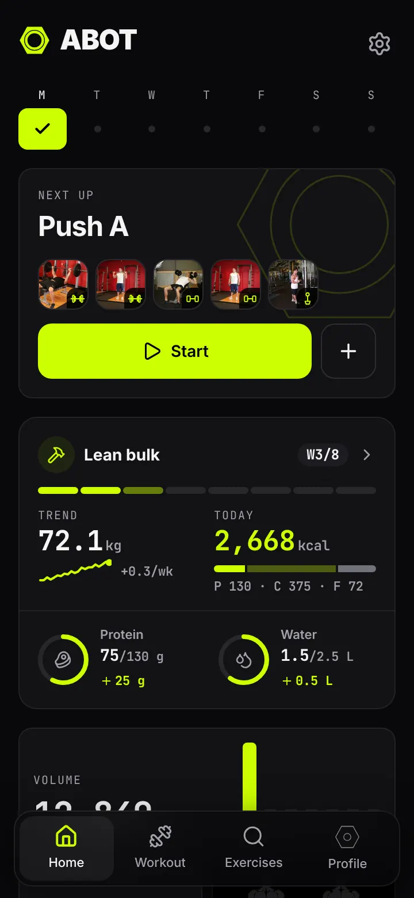
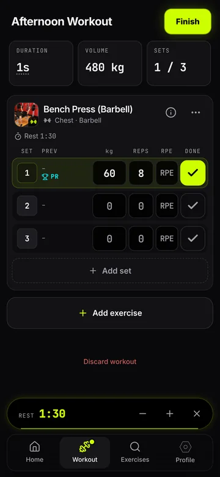
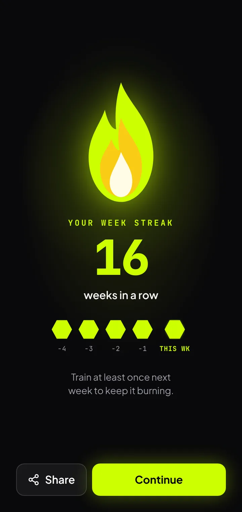
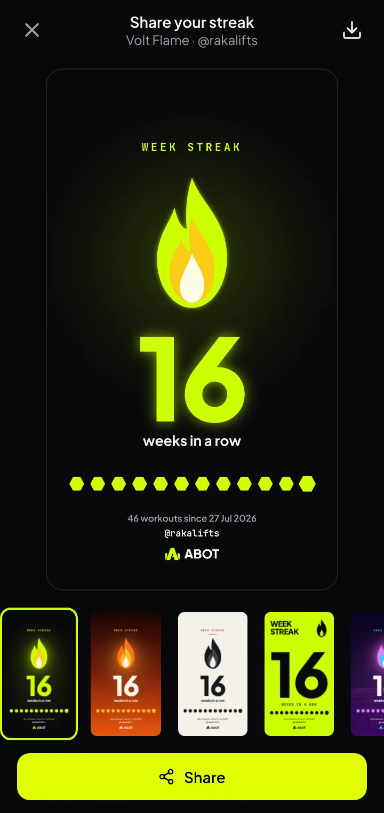
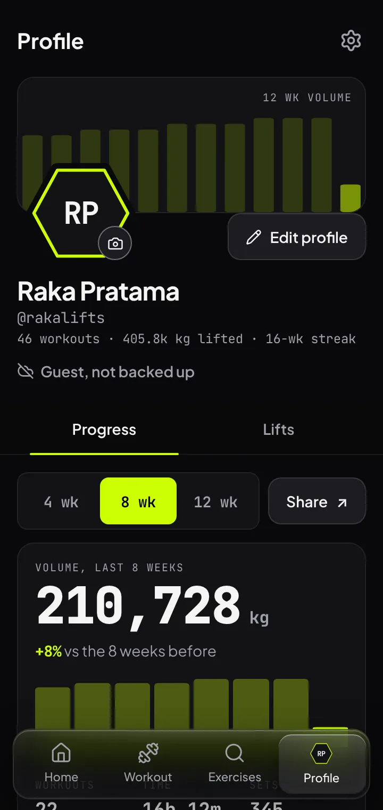
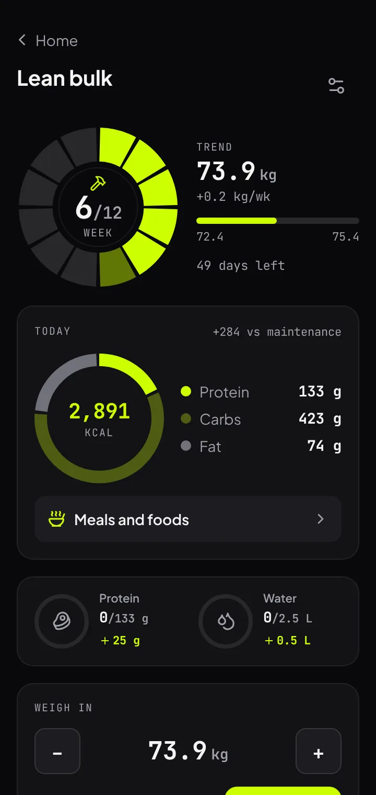
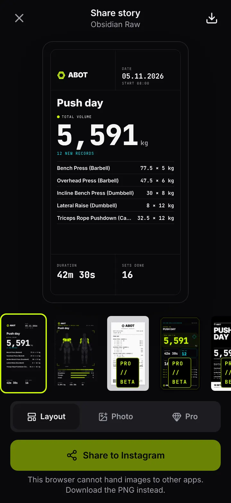
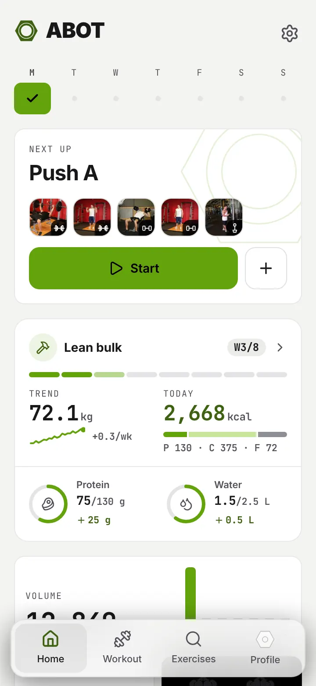

# ABOT: Gym Progress Tracker

[](https://github.com/jfr-wrld/ABOT/actions/workflows/android.yml)

ABOT (Javanese for "heavy") is a strength-training log for your phone. Log sets in the gym, keep
your routines, watch your records, progress and week streak, and share a finished workout or
your streak to your Instagram Story. It works offline, needs no account, and keeps your training
on your phone. Google sign-in is optional, for a cloud backup and the same data on two phones.

ABOT runs as an **Android app** (built with Capacitor) and in the **browser**, in **English and
Bahasa Indonesia**, with a dark and a light theme.

<p>
  
  
  
  
</p>
<p>
  
  
  
  
</p>

Screenshots show sample data from a generated backup file (`scripts/readme-screenshots.mjs` makes them).

## Contents

- [Download and install (Android)](#download-and-install-android)
- [Features](#features)
- [Your data and privacy](#your-data-and-privacy)
- [Build from source](#build-from-source)
- [Project layout](#project-layout)
- [Tests and the local-first audit](#tests-and-the-local-first-audit)
- [Contact](#contact)
- [Credits and license](#credits-and-license)
- [Ringkasan (Bahasa Indonesia)](#ringkasan-bahasa-indonesia)

## Download and install (Android)

ABOT is not on Google Play yet. Every push to `main` publishes a ready-to-install APK as a
GitHub release.

1. Open the [latest release](https://github.com/jfr-wrld/ABOT/releases/latest) on the phone and
   download `abot-1.0.N.apk` under **Assets**.
2. Open the file. Android asks to allow **Install unknown apps** for the browser or Files app you
   opened it with: allow it once, then tap **Install**.
3. If **Play Protect** warns about an unknown app, tap **More details**, then **Install anyway**.
   If the install hangs on "Installing", choose **Install without scanning** or pause Play
   Protect's scan for a moment.
4. Open ABOT. After the intro, **Allow access** explains each permission (notifications, camera,
   location). Allow the ones you want; Settings can change them later.

**Updating:** from 1.0.133 on, ABOT checks GitHub when it starts. A newer build shows a **New
version** sheet with what changed; **Update now** downloads it in the background (Android's
download notification shows the progress), and a banner offers **Install** when it is in. The
first time, Android asks you to allow installs from ABOT. Settings, About also has **Check for
updates**. An older build updates by hand once: install the latest APK over it; your data stays.
Every build since 1.0.5 is signed with the same key. An APK from before 1.0.5 must be uninstalled
once: export a backup first (Settings, Data & backup) or sign in with Google, then import or sign
in again after installing.

**Requirements:** Android 7.0 or newer. The live workout chip in the status bar needs Android 16.

## Features

### Logging
- Start an empty workout or one from a routine; add exercises, then log weight, reps and
  optional RPE per set. Warm-up, drop and failure sets are marked by letter.
- Previous numbers for each set, plates and bar per gym, supersets, reorder and replace.
- A rest timer starts when you tick a set; it sits above the tab bar within thumb reach.
- Between sets the same bar names where you are: the set you are on with its weight and reps
  (or the set before it while this one is empty), the exercise, the clock and sets done, with a
  solid wave along its edge while the workout runs. Tap it for shortcuts: Pause or Resume,
  Done set, Add set, and Go to it.
- Pause and resume the workout clock.
- Add up to six photos to a workout from the camera or the gallery. They show on the summary and
  in history, can be saved to the phone's gallery, and go into backup files.
- The Coach Pill under each exercise suggests the next target from your last three sessions:
  more weight, one more rep, or a deload when you are grinding.
- Sounds, synthesised on the phone so your music keeps playing: a tick on steppers, a latch when
  a set is done, a chord for a record, a tone when a workout starts and a chord when it ends,
  three pips at 3, 2, 1 seconds of rest and a beep at zero. Settings > Workout switches the
  sounds and the rest alert separately.

### Workout in the notification panel (Android)
- While a workout runs, a notification shows the next lift and set, and a clock Android ticks
  itself: rest counting down, otherwise workout time. It stays up with ABOT closed or the
  screen locked (a foreground service, so battery savers leave it alone).
- Buttons: **+30s**, **Skip rest** and **Log set** while resting; **Log set** and **Pause**
  otherwise; **Resume** while paused. Log set ticks the next set with its weight and reps
  (mid-superset, the next exercise in the superset).
- The next exercise's photo, a progress bar of sets done (one segment per exercise, Android
  16), and "Paused" in the status bar chip while paused. Tapping it opens the workout.
- Settings: show it for rest and workout, or rest only; second line with the next set's target
  or the total volume.
- The end of a rest rings and buzzes, even with ABOT in the background.
- On Android 16 the clock shows as a chip in the status bar (Live Update). Phone makers decide
  which apps get their own pill by the camera: on ColorOS (OPPO) turn on Settings >
  Notifications > ABOT > Live updates; HyperOS and One UI choose for themselves.

### Week streak
- Count the weeks in a row with at least one workout. A workout that starts or grows the streak
  opens on a flame screen before the summary, with its own sound; tap the streak on Home to play
  it again.
- Share the streak as a 1080 x 1920 story card in twelve themes, all free: Volt Flame, Inferno,
  Paper, Poster, Neon Grid, Blue Flame, Steel, Gold, Heatmap, Badge, Sunset and Terminal. Each
  shows the count, the last twelve weeks, the workouts since the streak began and your @username.

### Routines and templates
- Your own routines, plus a Template Vault of ready programs (PPL, Upper/Lower, Full Body,
  Calisthenics) to start or copy.
- Weekly workout schedule with reminders and a pack-your-bag call; on Android they arrive
  while ABOT is closed, with Start and Snooze buttons. The schedule also exports to your calendar.

### Progress and records
- Home: this week at a glance, volume, training days, muscle recovery and recent workouts.
- Records count once per lift per workout: heaviest weight, best estimated 1RM (Epley) and most
  volume in a set. The first time you log a lift is your baseline, not a record.
- Workout summary with a comparison to last time; workout detail with a body map of the
  muscles worked.
- Profile, Progress: a summary (volume against the weeks before, workouts, time and sets) with a
  page each for the weekly trend, muscles, the training calendar and the body phase. Lifts ranks
  your lifts by estimated 1RM. Edit profile holds your name, username, height, photo, bodyweight
  and account.
- Bodyweight log with a trend line that smooths out day-to-day water swings.

### Body phases: cut, lean bulk, recomp, strength peak
- Pick a phase, your body numbers and a goal in four short steps. ABOT sets today's calories
  and protein, carbs and fat (Mifflin-St Jeor plus your logged training), and draws the block as
  a weight plate that lights one segment per week, with a deload every fourth week.
- The rest of the app follows the phase: on a cut the Coach Pill holds the weight when sets get
  hard and drops a set instead of a deload, and the recovery map runs 15% slower; on a lean bulk
  it adds weight after clean sessions and recovery runs 10% faster; a strength peak moves
  compounds to 3 to 5 reps with at least 3 minutes of rest. Routine templates that suit the
  phase are marked.
- Relative strength (best compound e1RM per kg of trend weight) shows on a cut whether muscle is
  holding as weight comes down.
- Meals and foods: a meal before and after training sized from today's target, and 24 everyday
  foods and drinks (many easy to find in Indonesia) with calories, macros and a portion you can
  judge by eye. One tap adds 25 g protein or 500 ml water to today's tally.
- The targets are estimates, not medical advice.

### Exercises
- 138 built-in exercises with start and end photos that play like a short loop, steps and form
  cues, and a muscle map. About 800 more from the full catalog, downloaded once on request.
- The catalog opens from a button on Exercises, and each muscle section has its own figure.
- Your own exercises, with a video link if you like.

### Share to Instagram Stories
- Story Studio turns a workout into a 1080 x 1920 card in eleven layouts.
- Add a background photo from the camera, the gallery or the workout's own photos, with overlay
  and black-and-white.
- Your @username (from Profile) on every layout. Share opens the phone's share sheet, where
  Instagram Stories is a target; Download saves the PNG to the gallery (album ABOT).

### Gyms
- Bar weight and plates per gym; machine records stay per gym.
- Find gyms near me lists the real gyms around you from OpenStreetMap, so you add yours by name
  and place instead of typing it. A workout started within about 300 m of a saved gym picks it
  by itself (Android, with location allowed), and the summary and history show the gym tag.

### Settings
- General: language (Phone, English, Bahasa Indonesia; Phone follows the phone's language),
  theme (System, Dark, Light), kg or lbs, first day of the week.
- The whole interface is translated. Exercise names, instructions and the story card layouts
  stay in English.
- Visual effects: Auto, Full or Lite. Lite drops the glass blur and the movement for slower
  phones; Auto picks it for phones that report under 4 GB of memory or 4 cores or fewer, and
  with Data Saver or reduced motion on.
- Workout, Notifications (with a test alert), Data & backup, app permissions.
- FAQ, About (with Check for updates on Android, the Privacy Policy and the Terms of Use),
  Contact us, social links (coming soon), Sign out.
- Back, from Android's button or a "‹ Parent" link, returns to where the page was scrolled.

### ABOT // BLACK PRO
- Some features are marked PRO: the Coach Pill, body phases, the full recovery and symmetry
  readouts and most story layouts. During the founders beta every PRO feature is open to
  everyone.
- PRO can be bought with QRIS, e-wallets, virtual accounts or cards through Midtrans, signed in:
  a year (added onto any time left), lifetime, or the founder price for founder accounts. Prices
  are in rupiah and shown before you pay. The purchase follows your account to any phone, and a
  short celebration plays when it lands. A code can also be redeemed in Settings.

### Health apps (Android)
- Settings, Health apps connects ABOT to Android Health Connect. Finished workouts go there as
  weightlifting with estimated calories (MET method, from volume per minute, RPE and your body
  weight), on their own with Auto-sync on. Google Fit, Samsung Health and Huawei Health read
  them once their Health Connect sharing is on. Your latest weigh-in and last night's sleep
  come back: the weight feeds the calorie estimate, the sleep the recovery map.
- Every workout summary shows the calorie estimate and can share the workout as a `.tcx` file
  for Strava, Garmin Connect or Huawei Health. Android 8 or newer is needed.

### Backup and sync
- Export and import everything as a JSON file (`ABOT_BACKUP_YYYY_MM_DD.json`), no account
  needed. Restore by merging (nothing local is removed) or by replacing everything.
- Bring your history from Hevy or Strong: pick their CSV export in Settings, Data & backup.
  Exercise names are matched to the library and unknown ones become custom exercises; records
  include the imported sets straight away. Importing the same file twice adds nothing.
- Optional Google sign-in backs up to your own space and keeps two phones in step. The newer
  edit wins per item; an older version replaced by another phone is kept on the device.
  Setup for your own project: [`docs/cloud-sync-setup.md`](docs/cloud-sync-setup.md).

## Your data and privacy

- Your training is stored on your phone (IndexedDB) and works with no connection.
- ABOT has no ads, no analytics and no paid API. The network is used only for exercise photos,
  the optional full catalog download, backup if you sign in, buying PRO, the Android update
  check, and, in builds with Supabase set up, one small read of the public app settings row (`app_remote_config`: plan prices, the
  announcement, algorithm calibration) at most every 6 hours. That read sends nothing about you.
  Redeeming a code sends the code. "Find gyms near me" sends your position, once per tap, to
  OpenStreetMap to list the gyms around you: its Overpass service, or its Nominatim search when
  Overpass does not answer (no key, no account).
- Signing in copies your data to your own Supabase project, where row level security lets each
  account read only its own rows. Signing out keeps everything on the phone.
- The body phase, weigh-ins and the protein and water tally stay on the phone (the phase also
  goes into backup files). Food values are built into the app; nothing about your diet is sent.
- Story photos are drawn into the PNG on the phone and are never uploaded. Workout photos stay on
  the phone and go into backup files only if you include them; they are never synced.
- Buying PRO sends Midtrans the order, its amount and your account email; you enter payment
  details on Midtrans' page, never in ABOT.
- The Android app asks GitHub for a newer release when it starts (and at most every 30 minutes
  when it comes back), and downloads an update only when you tap Update now.
- The full texts: [Privacy Policy](https://abot-app.vercel.app/privacy) and
  [Terms of Use](https://abot-app.vercel.app/terms).

## Build from source

Requirements: Node.js 22. For the Android app also JDK 21 and Android Studio.

```bash
npm ci
```

```bash
npm run dev
```

The app runs at http://localhost:3000. Other scripts:

| Command | What it does |
| --- | --- |
| `npm run build` | Production web build |
| `npm test` | Unit tests (Vitest) |
| `npm run e2e` | Browser tests on a phone viewport (Playwright) |
| `npm run lint` | ESLint |
| `npm run audit` | Full local-first audit (below) |
| `npm run check:schema` | Supabase schema checks on a throwaway local Postgres |
| `npm run build:android` | Static export copied into the Android project |
| `npm run android` | The above, then opens Android Studio |

Cloud sync is optional: copy `.env.example` to `.env` and fill in your Supabase URL and anon key
([`docs/cloud-sync-setup.md`](docs/cloud-sync-setup.md)). Without it ABOT runs local-only.

Android details (static export, native plugins, signing, CI): [`docs/android.md`](docs/android.md).

The 104-second intro video (1080 x 1920, with its synthesised soundtrack) renders from real app
screens on sample data: run `npm run dev`, then `node scripts/intro-video/render.mjs`. It writes
`video-out/abot-intro.mp4`; scenes, sound cues and voice-over lines share one timeline in
`scripts/intro-video/timeline.mjs`. For the voice-over, put the take at `video-out/vo.mp3`; the
scripts to record it are in `scripts/intro-video/voiceover*.md`.

## Project layout

Next.js (App Router, static export for Android), TypeScript, Tailwind CSS v4, Zustand, Dexie,
Recharts, Framer Motion, Lucide icons, Capacitor 8.

- `src/app/`: screens (Home, Workout, Exercises, Profile, Settings, workout summary and detail,
  and `phase/` for the body phase, its setup and meals).
- `src/types/workout.ts`: the data model. Weights are stored in kg and converted at the UI edge.
- `src/lib/calc.ts`: 1RM, volume and record detection. `src/lib/session-insights.ts`: the record
  rule shown on screens.
- `src/data/repo/` and `src/store/persistence.ts`: storage behind a repository interface.
- `src/data/sync/`: merge engine and Supabase adapter; schema in `supabase/migrations/`.
- `supabase/functions/`: the Midtrans checkout and payment notification (Edge Functions);
  setup and test checklist in [`docs/payments-setup.md`](docs/payments-setup.md).
- `src/lib/story-exporter.ts`: the Story Studio layouts, drawn on a canvas.
  `src/lib/streak-card.ts`: the twelve streak themes.
- `src/lib/app-update.ts` and `src/store/useAppUpdate.ts`: the Android update check and download.
- `src/components/brand/mark-path.ts`: the logo as one path; `scripts/make-app-icons.mjs` draws
  the favicon and the Android icons from it. Brand PNGs in `docs/brand/`.
- `src/lib/phase-engine.ts`: body phases, trend weight, calorie and macro targets, and how they
  tune the coach and recovery. `src/lib/nutrition-guide.ts`: the food list and meal sizes.
- `src/lib/native/` and `android/app/src/main/java/app/abot/gym/`: Android-only pieces (files,
  notifications, permissions).
- `DESIGN.md`: palette, themes, typography and screen notes. `docs/plans/`: roadmap.

## Tests and the local-first audit

`npm run audit` runs, in order:

1. Type check, lint and unit tests.
2. A production build with every env file moved aside, so the app is proven to need none.
3. A scan of the browser bundle for any Supabase project URL or key.
4. A production server, with every route checked for an answer.
5. The whole browser suite against that server. It includes a check that a full training day
   makes no request outside the app, and that logging and finishing a workout keep working with
   the network cut.
6. The Supabase schema checks (skip with `npm run audit -- --skip-schema` when Postgres is not
   installed).

Env files are restored when the audit ends, even when it fails. Port 3100 must be free.

## Contact

Questions, bugs or ideas: [aljasidik@gmail.com](mailto:aljasidik@gmail.com), or Settings,
Contact us in the app (it fills in your app version). Social accounts are coming soon.

## Credits and license

- Exercise data and images: [free-exercise-db](https://github.com/yuhonas/free-exercise-db)
  (public domain, Unlicense).
- Body and muscle shapes: react-muscle-highlighter (MIT License).
- Food values: typical figures from [USDA FoodData Central](https://fdc.nal.usda.gov/) (public
  domain).
- Fonts: Plus Jakarta Sans and JetBrains Mono (SIL Open Font License).

Full notices: [`THIRD_PARTY_NOTICES.md`](THIRD_PARTY_NOTICES.md). No license has been chosen for
ABOT's own code yet, so all rights are reserved by its author.

## Ringkasan (Bahasa Indonesia)

ABOT adalah aplikasi pencatat latihan beban untuk HP: catat set di gym, simpan routine, pantau
rekor dan progres, lalu bagikan hasil latihan ke Instagram Story. Bisa dipakai offline, tanpa
akun; login Google opsional untuk backup cloud.

**Fase tubuh:** pilih cutting, lean bulk, recomp atau puncak kekuatan. ABOT menghitung target
kalori dan makro harian, menyesuaikan coach dan peta pemulihan, dan memberi contoh makan sebelum
dan sesudah latihan dari makanan sehari-hari (dada ayam, tempe, tahu, ikan nila, nasi, ubi).
Target ini perkiraan, bukan saran medis.

**Timer di status bar (Android):** saat latihan berjalan, notifikasi menampilkan hitung mundur
istirahat dengan tombol +30s, Lewati istirahat dan Catat set. Di HP OPPO (ColorOS), nyalakan
Pengaturan > Notifikasi > ABOT > Live updates supaya timer muncul di kapsul dekat kamera.

Tampilan ABOT tersedia dalam **Bahasa Indonesia** dan English: Pengaturan, Umum, Bahasa. Pilihan
"Phone" (Ikuti HP) otomatis memakai Bahasa Indonesia kalau bahasa HP-mu Indonesia. Nama gerakan,
instruksi gerakan, dan desain kartu story tetap dalam bahasa Inggris.

**Streak mingguan:** latihan yang memulai atau menambah streak membuka layar api sebelum
ringkasan; tap streak di Home untuk memutarnya lagi. Streak bisa dibagikan ke Instagram Story
dalam 12 tema, semuanya gratis.

**ABOT // BLACK PRO:** bisa dibeli lewat Midtrans (QRIS, e-wallet, virtual account, kartu) saat
login: tahunan, lifetime, atau harga founder. Selama beta founders, semua fitur PRO terbuka.

**Cara install di Android:**
1. Buka [rilis terbaru](https://github.com/jfr-wrld/ABOT/releases/latest) di HP, lalu unduh
   `abot-1.0.N.apk` di bagian **Assets**.
2. Buka file-nya, izinkan **Install unknown apps**, lalu **Install**. Kalau Play Protect
   memperingatkan, pilih **Install anyway**.
3. Mulai versi 1.0.133, ABOT mengecek versi baru saat dibuka: pop-up **Versi baru** menampilkan
   perubahannya, **Perbarui sekarang** mengunduh di latar belakang, lalu tekan **Pasang**. Data
   tetap aman.

Pertanyaan atau laporan bug: [aljasidik@gmail.com](mailto:aljasidik@gmail.com).
